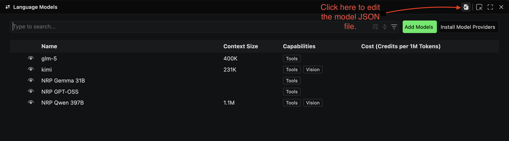
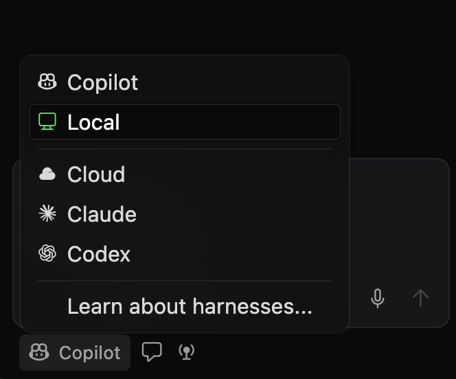
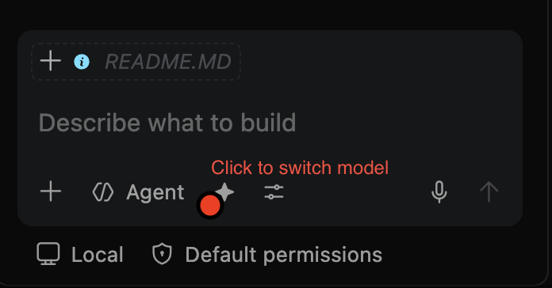

# Hands on with the NRP Nautilus Cluster.

> Adapted from NRP Winter Training 2026 material [here](https://github.com/nrp-nautilus/NRP-Winter2026-Training/blob/gh-pages/Beginner_Track_Training.md)


In our previous lab meeting we introduced the NRP and it's various services (compute and LLM inference), in this lab meeting we shall perform a hands-on exercise on basic operations the NRP Nautilus cluster.

For this session we shall be using a training namespace `sdsu-sethuraman-lab` which has been created. Join links have been posted on the lab slack.

## Setup.

> This hands-on assumes you have access to a machine with a linux-like terminal or WSL for Windows users. Root privileges are not required.


To get started, clone this repo down to your local machine and change into the directory.

```bash
git clone https://github.com/nrp-nautilus/NRP-HANDS-ON.git
cd NRP-HANDS-ON
```

### Joining the lab meeting namespace.

As we discussed previously, access and use of NRP resources is contingent on one having a namespace attached to their account. For this lab, we have created a namespace `sdsu-sethuraman-lab` for you to use.

Click on the join link sent to the lab Slack. You will be promoted to login with your SDSU credentials on CILogon. 

You will be presented with an LLM key that you will need to set up your favorite coding assistant e.g. VS Code copilot. Keep this key safe on your device.

### Software requirements.

#### 1. `kubectl` and `kubelogin`.


We will install kubenetes with the `kubectl`. On macOS this can be installed with hombrew. If homebrew is not installed, install it with:

```bash
/bin/bash -c "$(curl -fsSL https://raw.githubusercontent.com/Homebrew/install/HEAD/install.sh)"

```


```bash

# Using Homebrew
brew install kubectl

```

Verify the installation with:

```bash
kubectl version --client
```


Next, install kubelogin plugin with homnebrew;

```bash
brew install kubelogin
```

Verify kubelogin installation with:

```bash
kubectl oidc-login --version
```

### Environment setup.

Create a `.kube` directory on your home directory.

```bash
mkdir -p ~/.kube
```	

Download the NRP cluster config file from the NRP documentation page [here](https://nrp.ai/documentation/userdocs/start/getting-started/#:~:text=at%20this%20link.-,Cluster%20access%20via%20kubectl,-Do%20not%20skip) and move the `config` file to `~/.kube/config` directory.


### Sanity Check

Check your membership to the lab meeting namespace with the following command:

```bash
# If you know you’re a member of a namespace, you can set it as default.
kubectl config set contexts.nautilus.namespace sdsu-sethuraman-lab
```


## Basic Kubernetes commands.

To check the nodes available on the NRP cluster, run the following commands:

```bash
kubectl get nodes

# Check GPU availability - list nodes with GPU product labels
kubectl get nodes -L nvidia.com/gpu.product

# Count available GPU types
kubectl get nodes -L nvidia.com/gpu.product --no-headers | awk '{print $NF}' | sort | uniq -c

```

### Basic Cluster Operation.

To deploy any job on the cluster, we will need to create a YAML file that describes the resources, software tools and storage requirements for the job. 

#### Example Exercise: Hello World Pod.

You will find a simple hello world example in the [examples/pod/](examples/pod/) directory. The `pod.yaml` file describes a simple pod that echoes a hello world command and sleeps for 10 minutes.

> NOTE: Ensure you change the name attribute in the `metadata` section of the `pod.yaml` and `pod-write.yaml` file to include your. This is important to avoid naming conflicts with pods. For example;
>```YAML
>metadata:
>  name: pod-write-tmugoya
>```

Start your pod with the following command:

```bash
kubectl create -f examples/pod/pod.yaml -n sdsu-sethuraman-lab
```

Once successfully created, you can check the status of your pod with:

```bash
kubectl get pods -n sdsu-sethuraman-lab
```

View the logs for your pod with:

```bash
# View pod logs, replace with your username
kubectl logs test-pod-<username> -n sdsu-sethuraman-lab

```

To ssh into your pod, run the following command:

```bash
# SSH into your pod, replace with your username
kubectl exec -it test-pod-<username> -n sdsu-sethuraman-lab -- bash
```	

## Configure VS Code to use NRP Models for AI-assisted coding.

1. Open VS Code's Command Palette (Ctrl+Shift+P or Cmd+Shift+P on macOS) and search for "Chat: Manage Language Models".
2. Click on "Add Models" and select "Custom Endpoint".
3. Specify NRP's custom endpoint URL: `https://ellm.nrp-nautilus.io/v1/chat/completions`.
4. Paste in your API key.
5. When prompted to add models, paste the following JSON.

```JSON

{
  "name": "NRP",
  "vendor": "customendpoint",
  "apiKey": "${input:chat.lm.secret.2630e22e}",
  "apiType": "chat-completions",
  "models": [
    {
      "id": "glm-5",
      "name": "glm-5",
      "url": "https://ellm.nrp-nautilus.io/v1/chat/completions",
      "toolCalling": true,
      "vision": false,
      "maxInputTokens": 1048576,
      "maxOutputTokens": 100000
    },
    {
      "id": "qwen3",
      "name": "qwen3",
      "url": "https://ellm.nrp-nautilus.io/v1/chat/completions",
      "toolCalling": true,
      "vision": true,
      "maxInputTokens": 1000000,
      "maxOutputTokens": 100000
    },
    {
      "id": "deepseek-v4-flash",
      "name": "deepseek-v4-flash",
      "url": "https://ellm.nrp-nautilus.io/v1/chat/completions",
      "toolCalling": true,
      "vision": true,
      "maxInputTokens": 1048576,
      "maxOutputTokens": 100000
    }
  ]
}
```
> This will add 3 models, GLM 5.3, Qwen3.8-Flash-Next-FP8 and DeepSeek v4 Flash to your VS Code Copilot chat.


You can add additional models at any time by modifying the model JSON file by (Ctrl+Shift+P or Cmd+Shift+P on macOS) and search for "Chat: Manage Language Models" and "Open model JSON".



Next, you will need to select "Local" in the VS Code Copilot chat settings. 


To switch between models, click the star icon to switch models.



